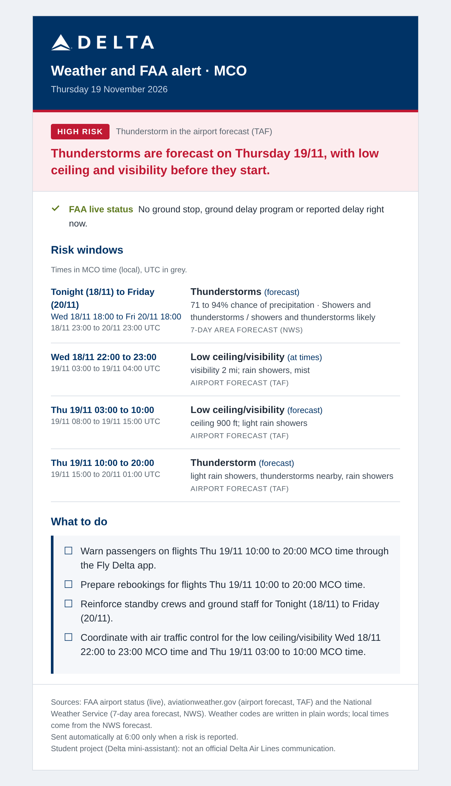

# Alerte du matin (workflow B) : le mail

Le mail part à 6 h seulement quand une source signale un risque. Depuis cette version, il est construit à partir
de la sortie `evenements` du nœud « imprévu » : le code range les faits des API, le LLM n'écrit qu'une phrase.
Aucune donnée n'est ajoutée : on regroupe, on traduit et on convertit.

## Les 6 changements

| # | Avant | Maintenant |
|---|---|---|
| 1 | Les risques écrits deux fois (texte de l'IA, puis « Live events ») | Une seule liste ; la source sur chaque ligne (TAF ou NWS) ; le statut FAA en direct en tête |
| 2 | Heures en UTC seulement | Heure locale de l'aéroport en premier, UTC en dessous |
| 3 | Une phrase | Un niveau de risque en couleur : High (rouge), Medium (orange), Low (vert) |
| 4 | Un créneau par période de la prévision | Les créneaux qui se suivent avec le même risque sont fusionnés (15:00-18:00 + 18:00-01:00 = 15:00-01:00) |
| 5 | Deux consignes générales | Les mêmes consignes approuvées, avec le créneau concerné |
| 6 | Codes météo (SHRA, BR, VCTS) | Mots simples (rain showers, mist, thunderstorms nearby) |

## Règles

**Heure locale.** Elle vient de la prévision à 7 jours du service météo américain (NWS) : chaque période donne son
heure locale (`2026-11-19T06:00:00-05:00`). Pas de base de fuseaux horaires à installer dans Dify, et le changement
d'heure est juste. Sans prévision NWS, le mail reste en UTC.

**Fusion.** Deux périodes de la prévision de l'aéroport (TAF) sont fusionnées si elles ont les mêmes risques, le
même type (FM, TEMPO, PROB) et se suivent sans pause. Pour le plafond ou la visibilité, on garde la valeur la plus
basse (« down to »). Les périodes NWS qui se suivent avec le même risque et la même certitude sont fusionnées
(« Tonight (18/11) to Friday (20/11) », pluie « 71 to 94% »).

**Codes météo.** Décodage standard des groupes METAR : intensité (`-` light, `+` heavy, `VC` nearby), description
(`SH` showers, `TS` thunderstorm, `FZ` freezing…), précipitation (`RA` rain, `SN` snow…), obscurcissement (`BR` mist,
`FG` fog…). Un code inconnu reste tel quel. TEMPO = « at times », BECMG = « becoming », PROB30 = « 30% chance ».

**Niveau de risque.**
- **High** : programme FAA (arrêt au sol, programme de retards, retards, fermeture) en cours ; ou orage, neige ou
  pluie verglaçante dans la prévision de l'aéroport (sauf PROB sous 40 %) ; ou tempête tropicale annoncée à 7 jours.
- **Medium** : autre risque dans la prévision de l'aéroport (plafond bas, visibilité, PROB30) ; ou risque annoncé
  (« forecast », « Likely ») dans la prévision à 7 jours.
- **Low** : seulement des risques « possible » ou « not confirmed » à 7 jours.

**Actions** (4 au plus, dans cet ordre, toujours les phrases approuvées) :
1. Programme FAA : coordonner avec le contrôle aérien ; préparer les réacheminements.
2. Orage (TAF) : prévenir les passagers des vols du créneau via l'app Fly Delta ; préparer les réacheminements.
3. Neige ou verglas (TAF) : renforcer les équipes de réserve et au sol pour le créneau.
4. Risque annoncé à 7 jours au-delà de la TAF : renforcer les équipes pour ces jours-là.
5. Plafond bas ou visibilité seulement : coordonner avec le contrôle aérien pour ces créneaux.

Les risques « possible » ou « not confirmed » restent dans la liste mais ne donnent pas d'action.

## Dans Dify

1. Code « imprévu » : coller `dify/noeud_code_imprevu.py`, ajouter la sortie `evenements` (String).
2. LLM « alerte » : le nouveau message Utilisateur (`dify/GUIDE_DIFY.md`, partie 4, étape 6).
3. Code « mail » : coller `dify/noeud_code_mail.py`, ajouter l'entrée `evenements` = `imprévu / evenements`.
4. Email : contenu = `mail / html` seul, Convert to HTML activé. Publier.

Le workflow A et le master ne changent pas. Si tu y recolles un jour `noeud_code_imprevu.py`, déclare aussi la
sortie `evenements`. Tests : `dify/tests/test_alerte_du_matin.py`.
